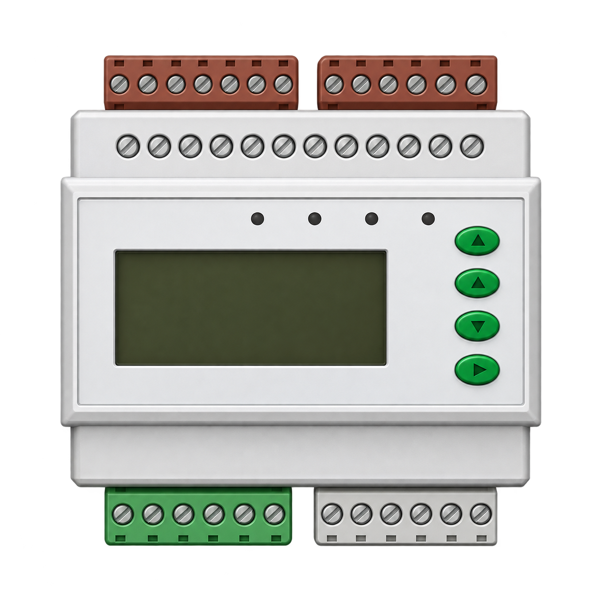
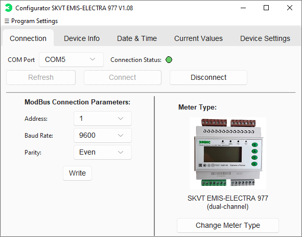
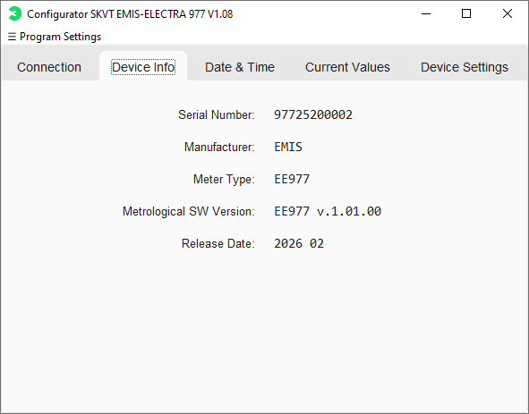
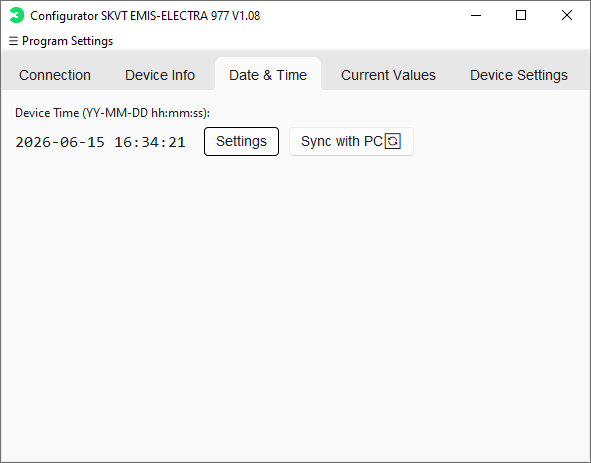
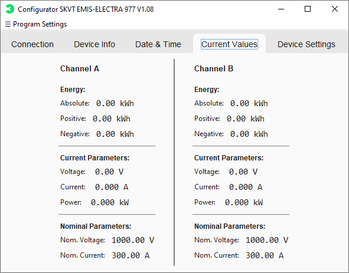
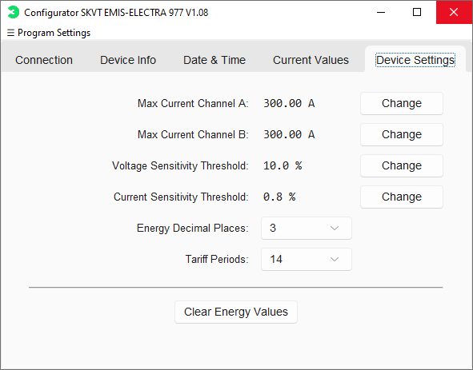

# Smart Meter Configurator

<p align="center">
  
</p>

[English version](README.md) · [История изменений](CHANGELOG.md) · [Безопасность](SECURITY.md)

[](https://github.com/Sugo174/Smart-electric-meter-configurator/actions/workflows/tests.yml)
[](LICENSE)

Конфигуратор счётчиков электрической энергии постоянного тока
СКВТ ЭМИС-ЭЛЕКТРА 977.

Программа предназначена для подключения к прибору через RS-485,
чтения показаний, настройки параметров, работы с тарифным
расписанием и заполнения информации о приборе.

Поддерживаются одноканальные и двухканальные исполнения.
Интерфейс доступен на русском, английском и китайском языках.

## Содержание

- [Скачивание и запуск](#скачивание-и-запуск)
- [Возможности](#возможности)
- [Запуск из исходников](#запуск-из-исходников)
- [Совместимость и ограничения](#совместимость-и-ограничения)
- [Технологии](#технологии)
- [Структура проекта](#структура-проекта)
- [Документация](#документация)
- [Скриншоты](#скриншоты)
- [Участие в разработке](#участие-в-разработке)
- [Лицензия](#лицензия)


## Скачивание и запуск

Готовые сборки не требуют установки Python.

- **Windows 10/11:** скачайте обычный Windows ZIP из [последнего релиза](https://github.com/Sugo174/Smart-electric-meter-configurator/releases/latest).
- **Windows 7:** скачайте архив с окончанием `-Windows-7.zip` для 64 бит или `-Windows-7-x86.zip` для 32 бит из [последнего релиза](https://github.com/Sugo174/Smart-electric-meter-configurator/releases/latest).

Все выпуски и описание изменений доступны в разделе
[Releases](https://github.com/Sugo174/Smart-electric-meter-configurator/releases).

1. Скачайте архив для своей операционной системы.
2. Полностью распакуйте его в отдельную папку.
3. Подключите прибор через адаптер RS-485 с установленным драйвером.
4. Запустите файл приложения из распакованной папки.

Сохраняйте все файлы сборки вместе. Для версии Windows 10/11
обязательна папка `_internal`. Не переносите исполняемый файл
отдельно от остальных файлов сборки.

Перед подключением выберите исполнение прибора:
одноканальное или двухканальное.

Подробная инструкция для пользователя:
[Запуск в Windows](docs/RUN_WINDOWS_RU.md).

## Возможности

- Усреднение напряжения, тока и мощности.
- Пошаговое заполнение протокола поверки Excel для одного или двух каналов с допусками по классу точности и автоматическим итогом.
- Управление источником напряжения на стенде и встроенная справка с оглавлением.

### Подключение к прибору

- Обмен по Modbus RTU через RS-485.
- Поддержка одноканальных и двухканальных приборов.
- Автоматический поиск параметров связи: адреса, скорости и чётности.
- Настройка параметров связи прибора.
- Обновление списка COM-портов с сохранением выбранного порта,
  если он остаётся доступным.

### Чтение и настройка

- Отображение напряжения, тока, мощности и накопленной энергии.
- Чтение и установка даты и времени.
- Синхронизация часов прибора со временем компьютера.
- Настройка максимального тока и порогов чувствительности.
- Настройка количества знаков после запятой при отображении энергии.
- Очистка накопленной энергии с подтверждением.

### Постоянная импульсного выхода

Доступные значения: 1000, 500, 200, 100, 50, 25, 20, 10 и 5 имп/кВт·ч.

Для одноканального прибора настраивается канал А,
для двухканального — отдельно каналы А и В.

Выбор значения сразу запускает запись в прибор.
Результат проверяется повторным чтением.

### Информация о приборе

Можно изменять:

- серийный номер;
- производителя;
- тип счётчика;
- строку версии метрологического ПО;
- дату.

Изменение строки версии ПО не обновляет прошивку прибора.

Серийный номер должен содержать ровно 12 цифр.
Для номеров формата `977 C P YY MM SSS` программа расшифровывает
исполнение по каналам, тип питания, месяц и год выпуска,
а также номер в серии.

### Автозаполнение по штрихкоду

Серийный номер можно ввести вручную или отсканировать сканером,
работающим в режиме клавиатуры. Для запуска нажмите Enter
или кнопку применения в окне автозаполнения.

После проверки номера программа синхронизирует часы прибора
со временем компьютера и записывает:

- введённый серийный номер;
- производителя `EMIS`;
- тип счётчика `EE977`;
- версию метрологического ПО `EE977 v.1.01.00`;
- дату принятия номера в формате `ГГГГ-ММ-ДД`.

Поля записываются и проверяются последовательно.
При ошибке часть полей уже может быть записана.

### Тарифное расписание

- Чтение, редактирование и запись суточного расписания.
- От 1 до 14 периодов с тарифами от 1 до 4.
- Первый период начинается в `00:00`.
- Время начала следующих периодов должно строго возрастать.
- После записи расписание считывается повторно для проверки.

### Проверка обновлений

Программа проверяет наличие нового выпуска на GitHub при запуске.
Ручная проверка доступна через меню настроек программы.

При обнаружении новой версии можно открыть страницу релиза
и скачать подходящую сборку. Автоматическая установка обновлений
не выполняется.

## Запуск из исходников

Для готовых ZIP-сборок этот раздел не требуется.

### Windows 10 и Windows 11

Нужны установленный Python 3.14, драйвер адаптера RS-485
и исходники проекта.

В PowerShell из папки проекта создайте отдельное окружение
и установите зависимости:

```powershell
py -3.14 -m venv .venv
.\.venv\Scripts\python.exe -m pip install -r requirements.txt
```

Запустите программу:

```powershell
.\.venv\Scripts\python.exe gui.py
```

Активация окружения не требуется: команды напрямую используют
его интерпретатор Python.

### Windows 7

Для совместимой сборки используется Python 3.8.10, 64 бит,
и отдельный набор зависимостей `requirements-win7.txt`.

Из папки проекта выполните:

```powershell
py -3.8 -m venv .venv-win7
.\.venv-win7\Scripts\python.exe -m pip install -r requirements-win7.txt
.\.venv-win7\Scripts\python.exe gui.py
```

Не устанавливайте зависимости из `requirements.txt`
поверх окружения Windows 7: для него зафиксированы отдельные версии.

### Проверка тестов

Для основного окружения:

```powershell
.\.venv\Scripts\python.exe -B -m unittest discover -s tests
```

Для окружения Windows 7:

```powershell
.\.venv-win7\Scripts\python.exe -B -m unittest discover -s tests
```

Тесты не заменяют проверку обмена с реальным прибором.

## Совместимость и ограничения

Программа предназначена для СКВТ ЭМИС-ЭЛЕКТРА 977
постоянного тока с обменом Modbus RTU по RS-485.

Поддержка других моделей и прошивок с отличающейся картой
регистров не гарантируется.

При автоматическом поиске проверяются выбранный адрес
и адреса от 1 до 10, а также скорости 1200, 2400, 4800,
9600 и 19200 бод с различными настройками чётности.

Обнаруженный COM-порт может быть занят другой программой.
Наличие порта в списке не означает, что его можно открыть.
Перед подключением освободите порт в другой программе.

Перед изменением параметров проверьте выбранное исполнение
прибора. Не отключайте прибор или адаптер во время записи.

Очистка энергии удаляет накопленные значения.
Выполняйте её только при необходимости и после проверки
подключённого прибора.

## Технологии

- Python и Tkinter.
- sv_ttk для оформления интерфейса.
- pyserial и MinimalModbus для обмена с прибором.
- PyInstaller для подготовки переносимых Windows-сборок.

## Структура проекта

- `gui.py` — интерфейс и запуск приложения.
- `device.py` — обмен с прибором и операции с регистрами.
- `constants.py` — версия программы, адреса регистров и константы.
- `update_checker.py` — проверка новых выпусков на GitHub.
- `requirements.txt` — зависимости основного окружения.
- `requirements-win7.txt` — зависимости сборки для Windows 7.
- `tests/` — автоматические тесты.
- `icons/` и `images/` — изображения интерфейса.
- `assets/` — материалы для документации.
- `CHANGELOG.md` — история изменений.
- `LICENSE` — текст лицензии MIT.

## Документация

- [Запуск в Windows и решение проблем](docs/RUN_WINDOWS_RU.md).
- [Сборка Windows 7 и Windows 10/11](docs/BUILD_WINDOWS.md) — на английском.
- [История изменений](CHANGELOG.md).

## Скриншоты

### Подключение



### Информация о приборе



### Дата и время



### Текущие значения



### Настройки прибора



## Участие в разработке

Подготовка окружения, проверка изменений и оформление сообщений
об ошибках описаны в [CONTRIBUTING.md](CONTRIBUTING.md).

Порядок сообщения об уязвимостях и обращения с конфиденциальными
данными описан в [SECURITY.md](SECURITY.md).

Оба документа — на английском языке.

## Лицензия

Проект распространяется по лицензии MIT.
Полный текст доступен в файле [LICENSE](LICENSE).